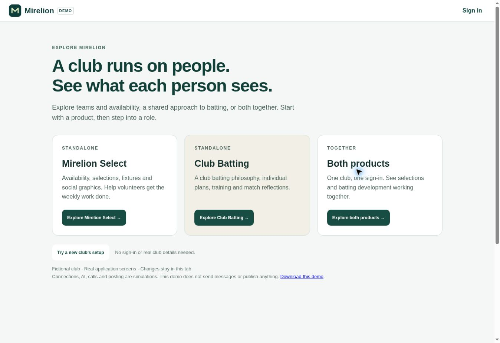

# Mirelion demo reconstruction — 22 October 2026

## Change

The prior downloadable demo lagged the live app and mixed role capabilities. The replacement offers Mirelion Select only, Club Batting only and both products, followed by separate accounts including just a player. It embeds app 0.8.62.250 and 41 current shared modules rather than maintaining old copies of application screens. A deterministic builder and input manifest make drift detectable.

The new-club path begins before requesting provider access, with no saved groups, fixtures or connection. It demonstrates preparation without marking a request sent, explicit sent confirmation, example credentials, season choice, group assignment, matching existing grades and fixture loading. Automatic checks become enabled only after the example connection and season are saved. Existing setup is visible on revisit.

Recent features represented include per-group selector grants and independent publication leads, explicit Club Batting participation, separate player/captain views, current Social Graphics menus, per-award group scopes, shared Week labels, fixture-specific team rounds and visible graphic proposals before Apply/Undo. A no-play abandoned Masters fixture is included without demanding scores.

## Validation

- 32 focused tests pass against the delivered HTML and the current connection module: navigation, all role journeys, all three product configurations, ordinary-player restrictions, publication boundaries, workshop role combinations, saved availability/reset, full new-club setup, empty manual groups, group sharing, all five award scopes, shared labels, no-play fixtures, proposal/Apply/Undo persistence and atomic team moves.
- Build freshness check passes. No live SDK import or production project configuration is embedded; the demo's CSP blocks external connections. Storage and RPCs remain in memory.
- Browser checks use the exact generated artifact, on desktop and in a 390px viewport. Verified the welcome/product chooser, ordinary-player Select and Batting screens, product switching, new-club request preparation, current awards UI and the gold-text proposal visibly appearing before Apply. Apply reports success and retains the preview.
- Browser testing caught and corrected the missing crypto.randomUUID fallback on HTTP/downloaded previews overlapping phone product/role selectors, and restoring the initial chooser with browser Back. Canvas rendering was inspected visually in addition to DOM tests.

Marketing links preserve existing trial/sign-in routes. Homepage leads to the three-product chooser; product pages lead to their own role chooser. Both marketing repositories use the single canonical demo URL.

## Boundaries

All people, club records and scores are fictional. No City data, live provider credentials or database records were changed. Calls, connections, polling, invitations, messages, AI and posting are explicitly simulated. Demonstrating those screens does not establish real Meta readiness, API approval for another club or production server authorization. Help videos were not rerecorded. This update does not clear the wider launch requirements in `mirelion-public-launch-readiness.md`.

## Deployment evidence

- App/demo PR #101 merged as `13ac8f9aca80f4f14d6f5c9ee312248c284e0870`. The live `https://clubbatting.com/demo.html` was opened in the browser: the three-product chooser and combined ordinary-player journey rendered correctly.
- The actual downloaded HTML exactly matches the tested generated artifact: SHA-256 `4682824e308a32879cd0bf4198fbe326072d7453de6e04aeec4cc50c1d2482c6`. The browser automation download callback timed out, but both resulting downloaded files were present and their hashes matched; no download failure is inferred from that callback.
- Mirelion website PR #1 merged as `1e8e7d9aafee1f72b1138f2a3067ea54781d00ba`. GitHub Pages run `39858434337` completed successfully for that exact commit.
- The new domain remains a separate open item: `https://mirelionhq.com/` returned an upstream connection failure in this browser. GitHub Pages still showed Enforce HTTPS unavailable after refresh. The marketing deployment succeeded, but HTTPS reachability and visual acceptance through that custom domain are not established here. No DNS or certificate settings were changed during this rebuild.

