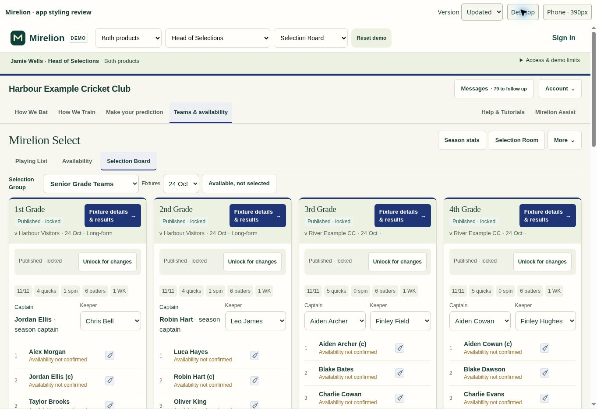
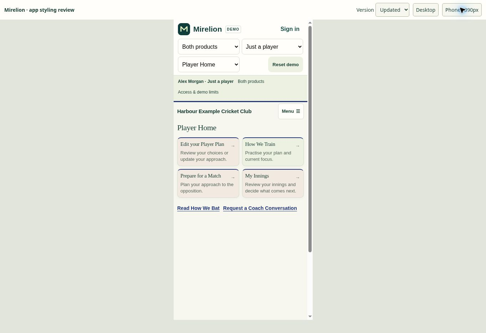

# Mirelion app appearance — 0.8.62.257

The app's cool grey surfaces and heavy headings did not match the public Mirelion site. This refresh carries the site's warm paper, forest text, sage and clay panels, and Georgia headings into the shared app styling and the generated demo.

## Scope

- Keep club-owned primary/accent colours on navigation, buttons and team borders. Preserve availability, warning, overfull-team and dropped-player indicators.
- Keep existing heading sizes, compact spacing, tap targets and mobile form sizing. Dense names, statistics, labels and controls retain their sans-serif text.
- Add sage team-card headers and clay/sage player tools without adding rows or changing workflows. Use the brand's forest colours on the shared sign-in panel.
- Rebuild `demo.html` from the same shared app source; update its wrapper to match. No live data, permissions, database or server changes.

## Visual review

Reviewed the generated demo in Chrome at desktop width and in a 390px phone frame: Selection Board, Player Home, Club Admin settings and Socials Awards. No horizontal overflow appeared on the phone Selection Board.

Before/after phone comparison of the first team card: 1043.75px high, starting at 488.1875px in both versions; content width and document scroll width both 375px. This sampled page retains its existing vertical footprint.

## Validation

- Demo freshness check: app 0.8.62.257, 43 shared modules.
- `npm run test:demo`: 48 passed, 0 failed.
- `git diff --check` passes.
- The keeper integration test previously assumed the default board date contained `selection-second`. That assumption fails on Saturdays in the unchanged baseline as well. The test now selects that fixture's date through the existing board date control before retaining all original assertions.

Prepared for review; not merged or deployed. The existing wider-launch readiness requirements remain separate from this presentation change.
