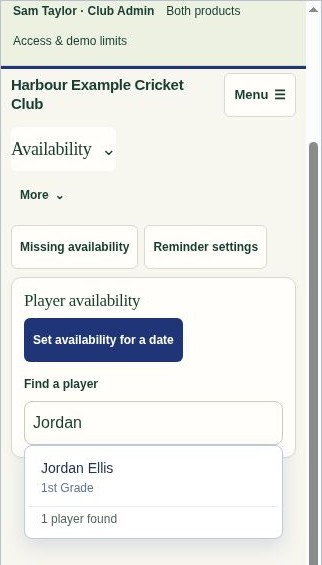
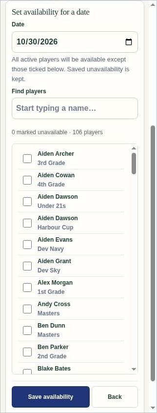
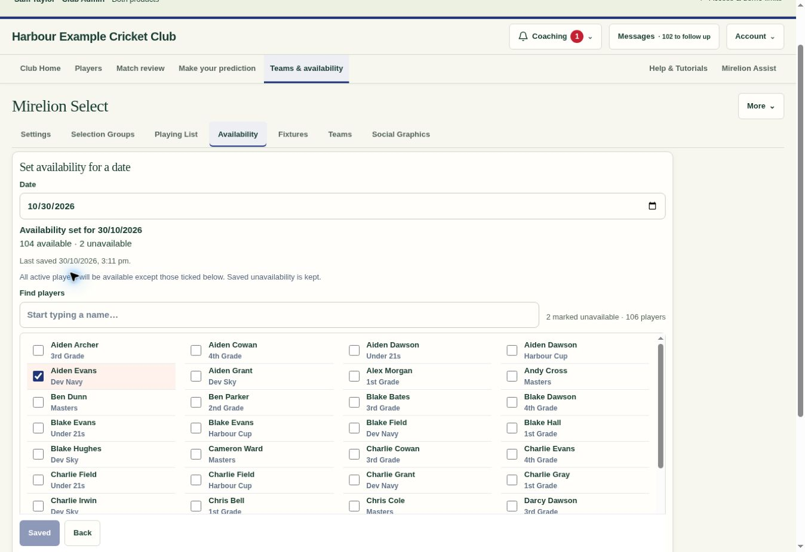

# Availability player search and larger checklist — .308

Availability now starts with an obvious Find a player text field. Matching active players appear while typing; the team is shown beneath each name to distinguish duplicate names. Choosing a result opens that player's existing calendar by roster ID. Case, accents and name-word order are handled locally from the already-loaded roster. Arrow keys, Enter and Escape work with the accessible combobox. Searching never saves availability, and switching players retains the existing unsaved-work confirmation and read-only permissions.

Set availability for a date uses a wider editor and a taller checklist, with multiple columns where space permits and a single column on phones. Opening the editor brings it into view. Save and Back remain reachable while scrolling. A count shows all marked unavailable players, including those hidden by a search. Checked rows remain marked through filtering, and saved exceptions, explicit reset, date switching, revision checks and uncertain-save behaviour are preserved.

Validation: 34 focused availability checks pass, including identity-safe duplicate-name selection, keyboard search, no-match queries, unsaved-calendar cancellation, read-only and own-player access, saved exceptions, concurrent updates and Selection Board return context. All 51 complete demo integration checks pass. The pre-existing concurrent-save test harness now supplies the existing selection-evidence pause stub. The generated demo uses the same application code and 70 shared modules; JavaScript syntax, demo freshness and whitespace checks pass.

Browser verification used only fictional demo data. Desktop search and a 106-player, four-column checklist were inspected. Two exceptions were marked across separate searches, saved and verified after reopening. Search and the final checklist were inspected at 390px and 320px widths; the narrow checklist has no horizontal overflow and its Save control stays visible. No live player availability was changed during verification.

This frontend-only release starts from live .306. The separate .307 season-format reminder proposal remains in draft PR #163 and requires its own migration and release.

