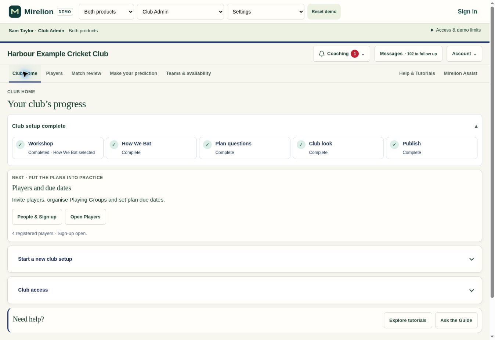
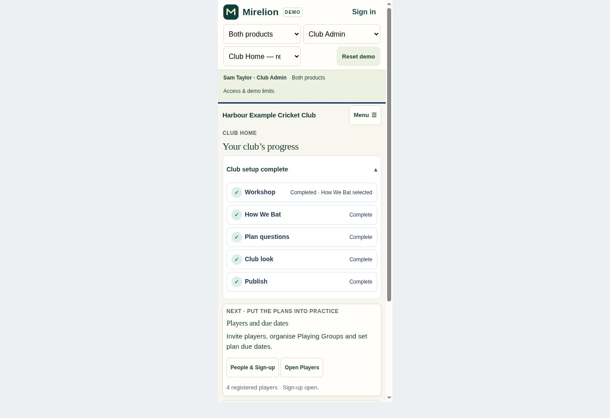

# Club Home .311

Completed Club Home setup was collapsed into a single strip. The user preferred seeing the five completed stages together, as in their second screenshot.

The completed overview now opens by default, showing Workshop, How We Bat, Plan questions, Club look and Publish. Its existing collapse control remains available. Each stage's detailed content still opens only when selected, and returning to Club Home closes the stage details while retaining the five visible tiles.

Validation: all 51 generated-demo tests passed, along with JavaScript syntax, demo freshness and whitespace checks. The actual interactive generated demo was checked in the browser at desktop and 390 px phone width. Opening How We Bat and returning to Club Home retained the expected overview and closed the individual stage. This is a presentation-only release, with no database migration.

