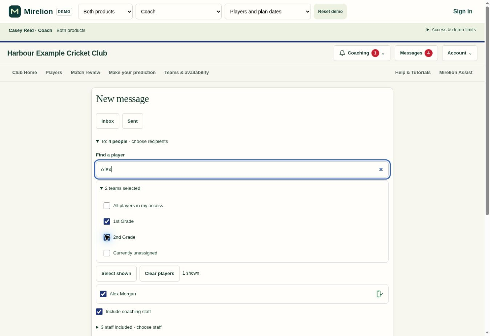
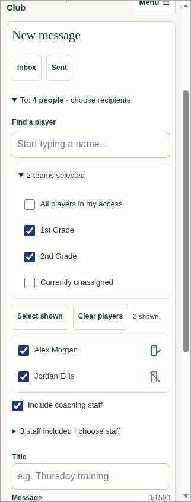
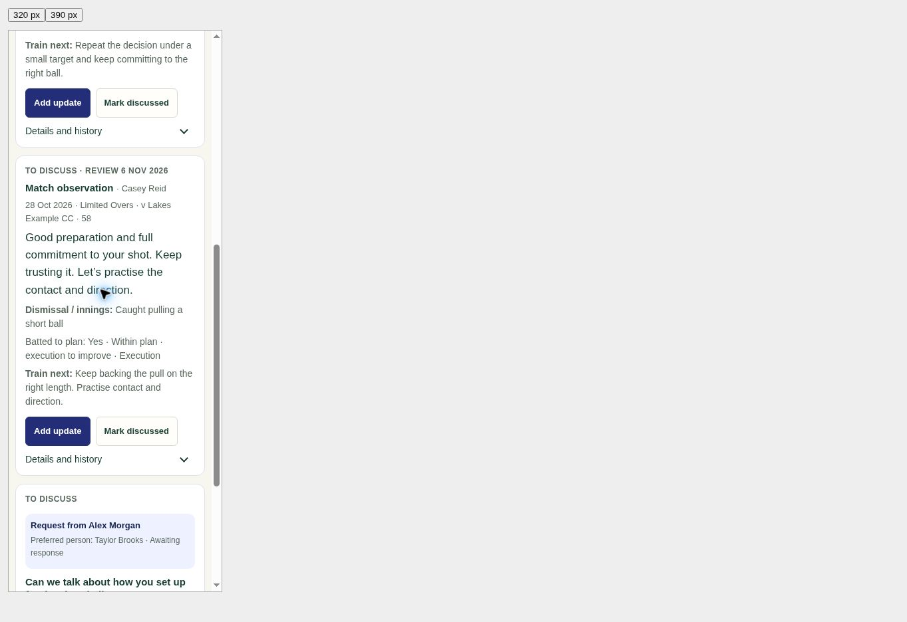

# Club Batting .309 review

Coaches were missing assigned conversations because Messages deliberately excluded coaching work. Players also saw ambiguous account-link labels, completed scorecards did not supply unpublished match teams, and selecting message recipients required scanning a long list.

## Result

- Assigned batting conversations enter the responsible person's normal inbox and open the exact conversation. An explicit preferred person takes priority over the club's batting-coach duty. Other authorised coaches keep shared conversation access without receiving the message. Existing Batting Coach titles are enabled automatically; custom titles can opt in through coaching-title settings.
- Each conversation has one message. Repeated events preserve read state; another person's substantive update can make it unread again. Deleted messages remain deleted. Current membership and player access are checked when reading. Backfill includes only still-open work needing attention, and does not replay completed discussions or send historical email.
- Coaching cards lead with the source note, Add update and Mark discussed. Details and history contains editing, innings evidence and focus review. Routine notes, past conversations and innings history are collapsed. Player reflection gates, videos, saved reviews and permissions remain available.
- Match Review accepts a verified completed scorecard's actual lineup, even when selections were never published. It reuses saved scorecard identities, captain and keeper and provisions missing batting profiles safely. Drafts, cancelled fixtures, opted-out groups, stale/mismatched source data and ambiguous identities remain excluded. It does not publish selections or generate team-publication messages.
- Successful shared sign-up may merge a welcome-message-only shell into the existing roster profile, preserving those messages and their read state. Independently populated histories, deliberate unlinks and identity clashes remain protected. The Players list says **No confirmed sign-up** when no matching confirmed account exists and **Account match needs review** only for an actual matching conflict; linked accounts use the normal player status.
- New message supports name search, a taller scrolling checkbox list, whole-team checkboxes, several teams together and All players in my access. Overlapping teams are deduplicated, filtering retains checked choices, and individual exclusions survive team changes. Staff selection remains separate.

## Validation

- Shared-account database tests: 5 passed, including preserved message history and protected competing histories.
- Completed-scorecard database tests: 5 passed, covering lineup identity/provenance, cancellation and opt-out checks, write eligibility and access helpers.
- Assigned-message database tests: 7 passed, covering recipient scope, preferred people, repeat events/read state, independent reflection mismatch and revoked access.
- Sign-up status database test: passed.
- Latest focused UI run: 18 passed across coaching inbox, recipient picking and scorecard identity UI.
- Completed-scorecard review rows, score inputs and existing coaching/navigation regressions passed. The generated-demo suite passed all 51 tests.
- JavaScript syntax, generated-demo freshness and whitespace checks passed.
- Actual generated demo checked on desktop and at 320/390 px phone widths. Verified searching with two teams checked and opening an assigned inbox message into its conversation. Demo data is fictional; no real messages were sent during QA.

## Deployment state and order

The shared-account-claim migration was applied on 30 October 2026 to fix the reported live sign-up problem. Two confirmed linked roster accounts were repaired without losing their existing player records or welcome messages. A subsequent check found zero mismatches among 33 linked playing accounts. Security and performance advisor results introduced no new notices.

The remaining three migrations and .309 frontend have **not** been deployed at review preparation. The .307 reminder branch is not part of this change.

On an approved .309 release, apply the remaining migrations in timestamp order, then deploy the matching frontend. The account-claim migration already exists in live migration history and must not be replayed as a new version. Verify the live version, assigned coach inbox, completed-scorecard match team, player status and recipient search. Retain .308 as the frontend rollback point; all migrations preserve existing public API contracts and data.

## Screenshots

