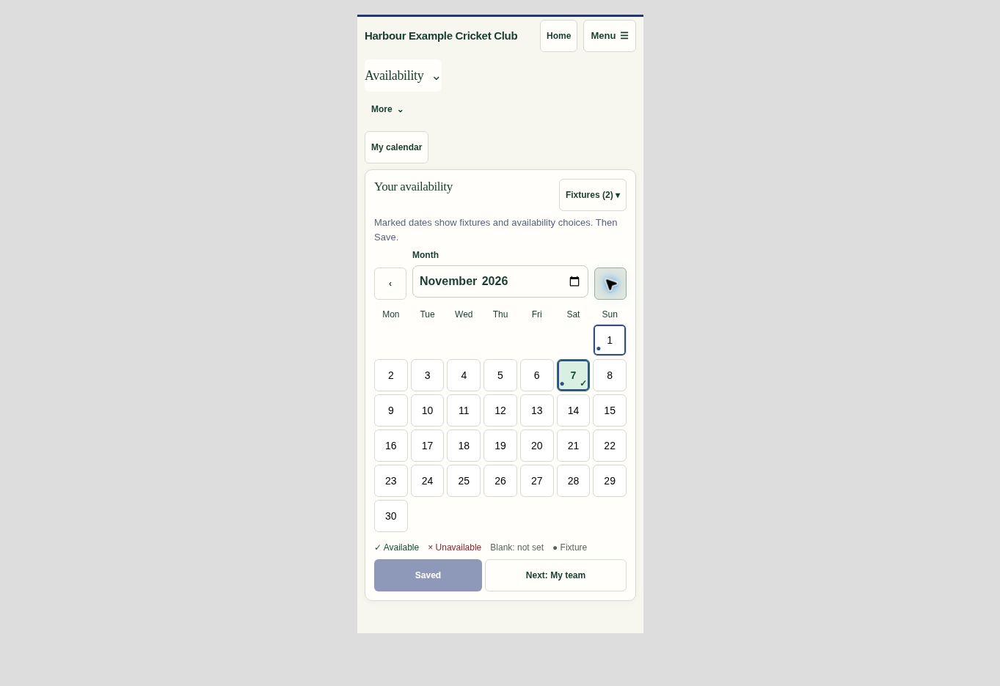
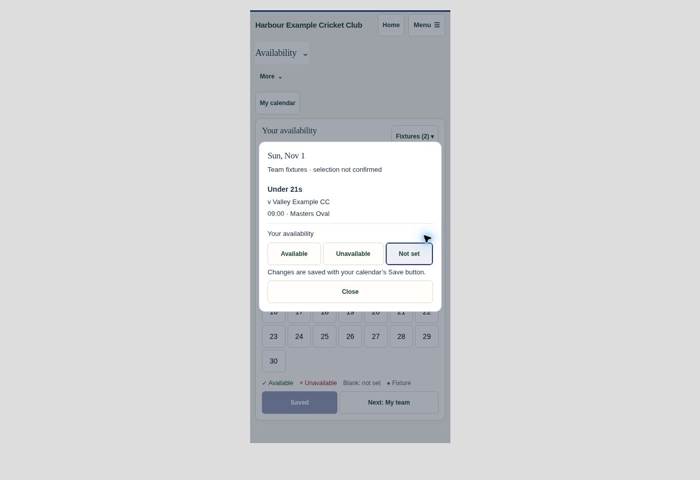
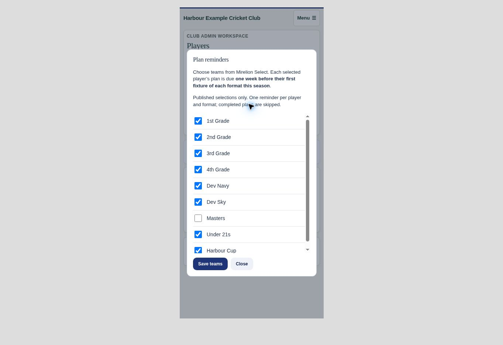

# Fixtures calendar, trials and automatic Player Plan dates — .306

Players can open Find fixtures on their own availability calendar, choose several teams and retain those choices for the current PlayHQ season. Only the optional module and one club-scoped lookup load on that explicit action; calendar browsing, saving and navigation reuse the snapshot. Refresh fixtures is explicit. Blue outlines/dots preserve the existing green/red/unset availability states. Opening a fixture does not change availability; choices still use the calendar's normal Save and retry flow.

The lookup returns current-season imported provider dates and opponents, including pending source corrections and both match days. Cancelled, abandoned, bye and historical-season imports are excluded. Manual fixtures appear only after Include in fixtures calendar is checked. Add Trial game creates a separate calendar event for the whole club or multiple teams without inventing a selection team. Targeted trials use the player's saved usual grade, resolved through the existing group matcher, and work without selection history. Whole-club and eligible usual-team trials appear automatically after Find fixtures is opened.

Linked clubs now use Players → Plan reminders instead of manual Plan dates. Club Admin chooses active Mirelion Select teams once, including cup and age-group teams. Published selections maintain one current-season deadline per canonical player and format, seven days before that player's first selected fixture. Both days, overlapping teams, withdrawals, cancellation, source-season changes and linked identity changes are handled on the existing write events. A bounded hourly job reads the indexed saved-date queue; it never polls PlayHQ or scans fixtures. Completed sections and accounts without a verified active link are skipped. A stable season/user/format message key prevents duplicate reminders, including after settings retries or re-enabling a team. Existing messages covering the same format/deadline are reused. Delivery eligibility is checked again by the existing message pipeline. Unlinked Club Batting keeps manual dates.

Development and tests used fictional data and read-only production checks. Read-only verification found City's 1 November DBs and U21s T20 teams published; U16 SG Moore Cup is not yet published. Masters is separate and can stay unchecked. The deduplicated published-team check found 18 selected roster entries, 11 verified registered accounts, three completed T20 plans and eight incomplete T20 plans. City-specific team IDs and recipient data are not included in the code or fictional demo.

Validation: 10 new database/UI tests pass, using PGlite and the complete delivered demo. They cover season/source filtering, publication-only recipients, usual-team trials, permissions, cancelled/withdrawn selections, complete/unlinked players, overlapping teams, idempotent/uncertain saves, manual fixture opt-in, standalone dates, cached fixture browsing and stale-account responses. The existing 18 Home/availability/navigation checks pass, and all 51 full demo integration checks pass. The generated demo is current with 70 shared modules. No production fixture or trial was created for testing.

Browser review used the delivered fictional demo: 390px player calendar and fixture dialog, a 320px calendar/filter without horizontal overflow, desktop and phone reminder settings with Masters unchecked, save/reopen persistence, and a multi-team trial saved successfully through Add Trial game. The public GitHub source upload was rejected by automatic approval review, requiring explicit approval of that destination. No feature migration or release has been deployed. Independently, the user-authorized eight T20 reminders were created through the existing Messages system and verified accessible to their eight recipients. Automatic approval review separately rejected email fallback dispatch as not explicitly authorized. Email fallback was disabled for these eight messages and no email was queued; all eight remain available in-app. Their stable message keys are adopted by this update when activated, avoiding a second reminder.

The .305 Home improvements are included in this release because that preceding local revision has not yet been published.

