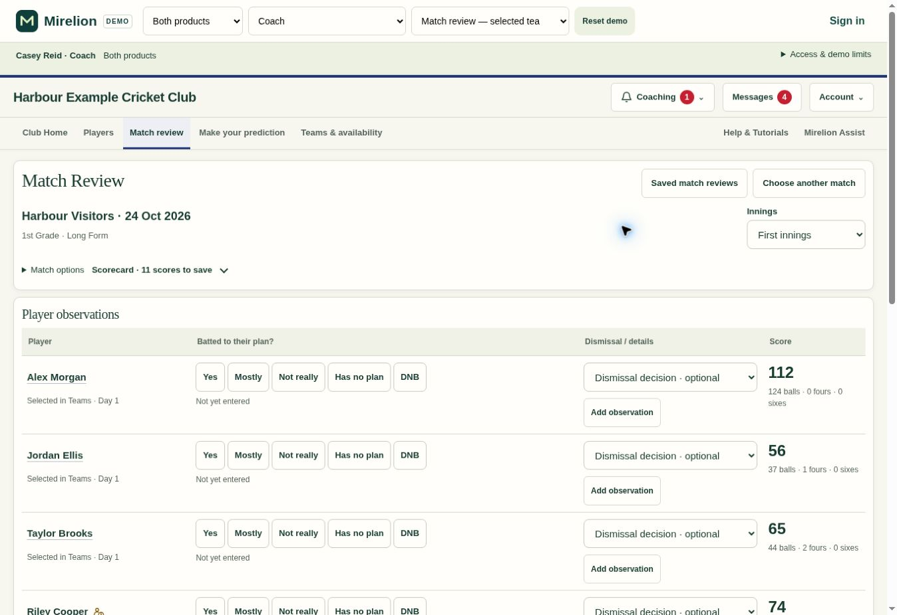
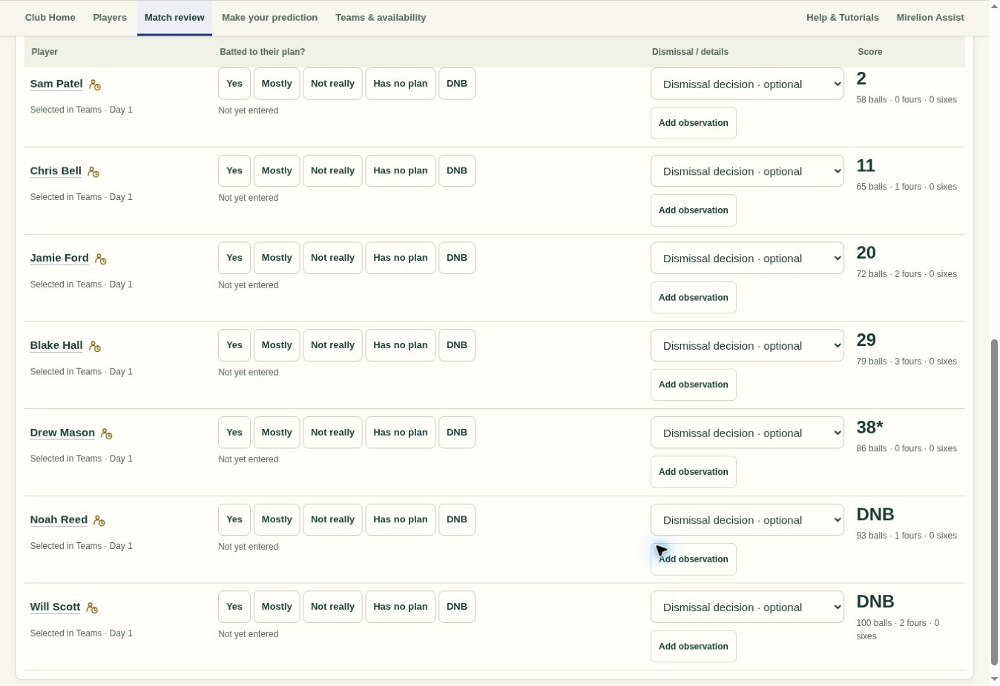
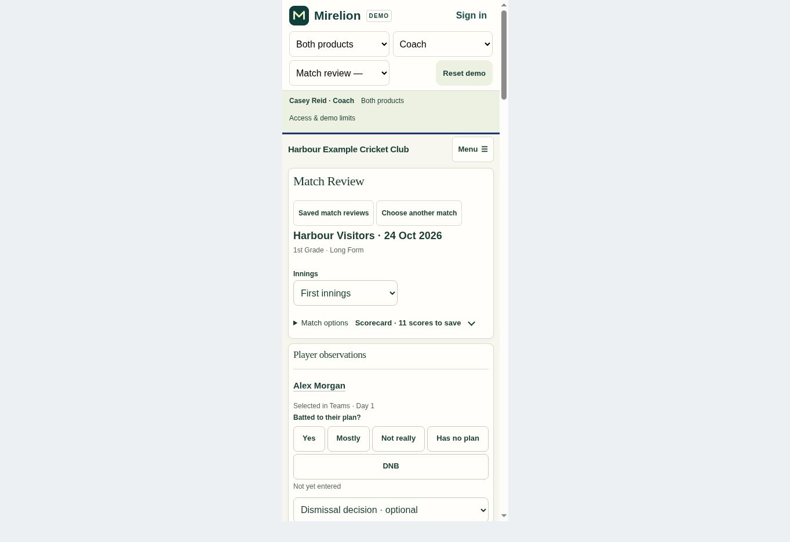
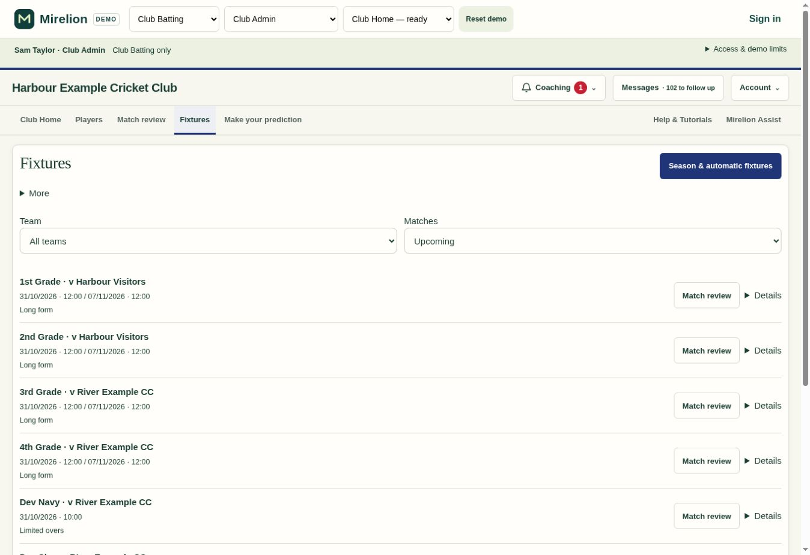

# Club Batting .310 review

Match Review reopened a previously saved game on section entry and placed repeated match fields and scorecard controls above the players. Once a coach scrolled down the team, the table headings disappeared. Club Batting-only clubs also lacked the season-fixture setup available through Mirelion Select.

## Result

- Explicit Match Review navigation opens the match chooser. Back/Forward still restores its prior destination, and unsaved or uncertain saves keep their existing guards.
- An opened match uses one compact header with its opposition, date, team and format. Repeated editable fields are hidden until needed. Innings selection appears for long-form or later innings only.
- Match options contains refresh, correction and Help. Scorecard details start collapsed. The ambiguous **Use scores for this innings** button is removed; only changed eligible scores offer **Add N new/updated scores to review**, followed by the normal Save flow. Unchanged scores do not create an action.
- Player observations follow directly below the match header. Occasional removal controls live inside More. Routine saved status no longer adds a footer.
- Desktop column headings stay beneath the sticky navigation while the team scrolls. Their offset follows navigation size changes. Phone cards repeat **Batted to their plan?** beside every player's choices.
- Only Club Batting staff at clubs without Select see the new **Fixtures** section. Admins use **Season & automatic fixtures** to reuse the existing PlayCricket connection, season mapping, import and scheduled checks. **More** provides manual fixtures, trial games and team management. Coaches can open permitted fixtures in Match Review.
- Linked clubs keep their existing Teams & availability setup. There is no duplicate fixture collection, connection, polling schedule or startup request.

## Database scope

`20261030083323_club_batting_fixtures.sql` introduces a narrow Club Batting fixture API and extends the existing shared fixture/import gates. It does not enable Select, grant selector rights or publish selections. A missing backing configuration is created disabled, with an explicit fixture-storage marker. The legacy participation rule retains ungrouped players when this storage-only row is present.

Writes require a current Club Admin and active Club Batting entitlement. Coach reads retain their existing match-review scope. Request receipts, fixture revision checks, source team identity, published-team restrictions and the existing match-history/roster identity triggers protect corrections and retries. Existing clubs' access rows, opted-out teams and saved history are preserved.

The migration changes shared import function definitions using fail-closed expected-text replacements. A changed production definition must be reviewed before deployment rather than silently accepting a partial patch. The test baseline contains schema and function definitions with synthetic records only.

## Validation

- Generated-demo suite: 51 passed.
- Focused interface/navigation integration run: 44 passed, including opening Match Review, section reset, pending-save protection and fixture visibility.
- Latest controls run: 45 passed across navigation, standalone fixture UI and scorecard identity/actions.
- Latest standalone demo run: 2 passed after normalising legacy fictional two-day format labels.
- New fixture database suite: 9 passed. It exercises the real shared importer and source correction code, disabled access bootstrap, legacy player participation, idempotent save, coach scope, old selector denial, team creation and existing history guards.
- Combined new fixture and completed-scorecard database run: 14 passed. The fixture suite was rerun after the final active-team context filter.
- JavaScript syntax, migration/source equality, generated-demo freshness and whitespace checks passed.

Browser visual checks used actual DOM rendered by the generated demo with fictional data, at desktop and 390 px phone width. Repeated full interactive-demo browser navigation timed out, so the rendered DOM was captured by the executable JSDOM harness and opened in the browser with the exact sticky-header helper attached. This verifies layout, responsive labels and scrolling, while automated executable-demo tests verify interactions. It is not a live production-session test. All four desktop headings were measured at 50 px below the navigation after scrolling; phone content fit its viewport without horizontal overflow.

## Release state

.309 remains live at review preparation. This .310 frontend and migration are prepared for publication, with standing publication approval given by the user on 30 October 2026. The separate .307 reminder work is not included.

On publication, run the normal security/performance advisor comparison, apply the migration before the frontend, verify the deployed .310 assets and check both standalone and linked-club entry points. The shared season worker and Edge Function require no separate deployment. Retain .309 as the frontend rollback point; the additive fixture API preserves its public contracts.

## Screenshots

