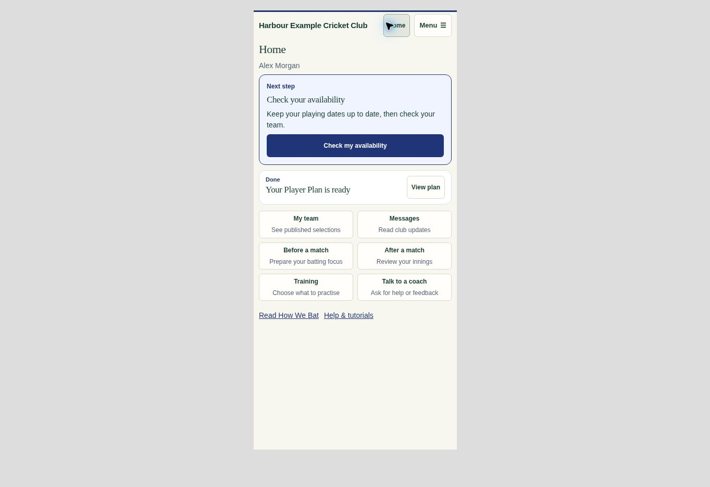

# Player phone guidance · 0.8.62.305

The player Home previously gave a completed plan the same space as the next task. It now leads with availability after plan completion, keeps the completed plan in a compact row, and labels everyday actions by the task: My team, Messages, Before a match, After a match, Training and Talk to a coach. An incomplete plan remains first. Batting-only players with a completed plan get Training highlighted as the next action.

The player’s own saved availability calendar offers Next: My team beside Saved. That shortcut disappears while the calendar has unsaved edits. Selector return-to-board context, retries, permissions and Home/history navigation remain intact. There are no added RPCs, polling, startup feature downloads or database changes.

Existing visibility rules were verified: disabled predictions remain configurable only by Club Admins; all other roles lose the navigation and direct route. Newcastle City’s live prediction setting was read-only verified as disabled. Assist remains staff-only; an ordinary player does not download its optional workspace. Playing staff retain their legitimate staff access.

## Verification

- Shared demo rebuilt and freshness checked against app 0.8.62.305 (67 modules); JavaScript syntax and diff whitespace checks passed.
- All 38 targeted Home, prediction loading, availability, Assist loading and demo tests passed. The full demo integration suite also passed all 51 tests. The isolated availability test harness now includes the existing selection-evidence pause/invalidation dependency. The prediction voting test explicitly selects the upcoming fictional innings date, which can fall next week on Fridays–Sundays.
- CUA visual review of the delivered shared demo at 390 × 844, 320 × 740 and desktop widths. No horizontal overflow at 320px; Home and the six actions fit in the phone viewport.
- Browser journey: availability → edit date (Next hidden) → Save (Next shown) → My team → Home. Admin unchecked predictions → saved → switched to player; the navigation contained neither predictions nor Assist.
- QA used fictional demo data; no live player messages or writes.

The phone image hides only the demo’s role/product chooser so the shared app can be reviewed at an actual 390px width. No player screen was redrawn or substituted.
