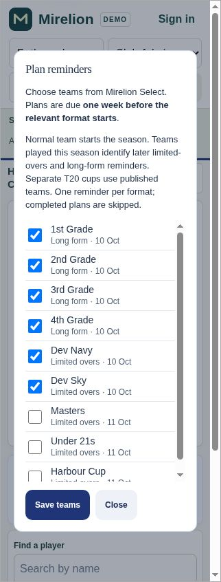

# Season formats and Player Plan reminders — .307

Imported fixtures now determine which formats each opted-in team plays and when they start. A player's existing Normal team supplies their first season requirements before teams are published. Once current-season line-ups are known, all relevant teams they have played for supply later limited-overs and long-form requirements. A Dev player who has played senior grade before long form starts is included; a Dev-only player is excluded when Dev has no long-form fixtures. No grade names, hierarchy or club-specific IDs are hardcoded.

Separate T20 cups use published teams. The only Normal-team T20 fallback is the team's opening fixture of the season, before there is regular-team history. The deadline stays seven days before the first relevant fixture. If a cup team is published after that deadline, its eligible players enter the existing reminder queue at publication. Overlapping teams still produce one reminder per player, format and season. Completed plans, inactive or unverified accounts and unchecked teams retain their existing exclusions. Standalone Club Batting keeps manual Plan dates.

Completed, explicitly linked scorecards take precedence over published line-ups. Canonical player links are reused; names are never used to merge people. Current active PlayHQ season mappings, source corrections, cancellations, roster membership and Normal-team changes feed a private coalesced change queue. The existing hourly worker refreshes changed clubs before delivery and withholds reminders for any club whose refresh failed. Ordinary draft moves, startup and calendar reads do not scan history or fetch new provider data. Settings saves retain the existing permission, revision and identical-request retry checks.

The reminder checklist displays each team's formats and first dates from imported fixtures. The existing Usual grade field is labelled Normal team, without adding a second membership system. Shared help and the fictional demo describe the same rules.

Validation: six database tests pass, including the retained .306 regression, preseason requirements, Week 6 senior history, actual-versus-published identities, Dev-only exclusion, late T20 publication, completed and unlinked players, deduplication, corrections, season changes, roster additions/removals, private access and recovery after a failed refresh. All 26 focused Home/availability/settings checks and all 51 full demo integration checks pass. The settings tests also verify fixture-format labels and save/reopen persistence. JavaScript syntax, migration/source parity, generated demo freshness (70 shared modules) and whitespace checks pass.

The exact generated demo was inspected on desktop and in 390px and 320px phone viewports. The checklist scrolls independently, format dates remain readable, and Save teams and Close remain visible. The image below is fictional demo data, not Newcastle City's live configuration.

Status: prepared for review on the .307 branch; not merged, not deployed, and the .307 migration has not been applied to production. Live .306 and the separately authorised Newcastle City checkbox update are complete. Deploy the included migration before publishing the .307 frontend.

