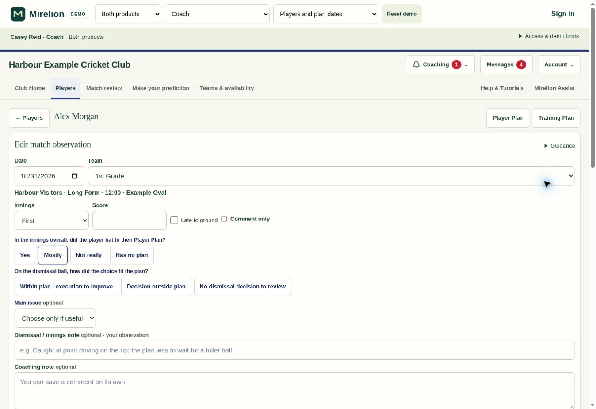
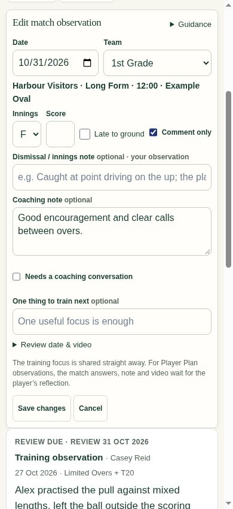

# Independent Match Observation contributions — .314

A contributor can save a comment, either quick assessment, an innings note, a main issue, a training focus or a conversation flag without completing unrelated fields. Comments alone become general notes automatically. The compact Comment only option remains available to hide assessments. Fields left unanswered remain null, including after reopening the saved observation.

An empty observation now changes the save button, explains what is missing and focuses the comment. Existing Saving, Saved, confirmed receipt and uncertain-retry handling remains in place. The Match Observation score label is now Score; its existing downloaded-score binding is unchanged.

Client alignment and server coaching-message comparisons use only assessment fields supplied by both people. Omitting a dismissal answer therefore cannot create a false mismatch. Actual differences and explicit follow-up requests retain their existing behavior. Training assessment requirements are unchanged.

## Validation

- 16 focused tests passed across observation fixtures, save safety and shared match arrivals. Both linked-product and Club Batting-only demos save and reopen a comment with no checkbox or assessments, independently save individual fields, preserve nulls and retry the original receipt.
- The production database rollback test first reproduced the required-answer failure, then passed after the migration. It covers independent fields, null storage, true versus missing-answer mismatches, identical receipt retry, empty and invalid input, separate authors on the same innings, author-only edits and ordinary-player denial. All synthetic records and queued messages were rolled back.
- Supabase security and performance advisor findings were unchanged by the migration. No table, policy, permission or background job was added.
- Syntax, generated-demo freshness and whitespace checks passed. The release uses the same 73 shared demo modules as .313.
- Desktop visual verification saved Mostly with no dismissal answer or comment, then reopened it. Phone verification saved a comment without selecting any assessments or the Comment only checkbox, then reopened the same saved note. Screenshots use fictional demo data.

## Deployment

The paired migration is `20261031002348_independent_match_observation_fields.sql`. It updates existing observation validation and null-aware coaching comparison functions; it does not rewrite stored player observations. Keep the SQL source and migration identical.
