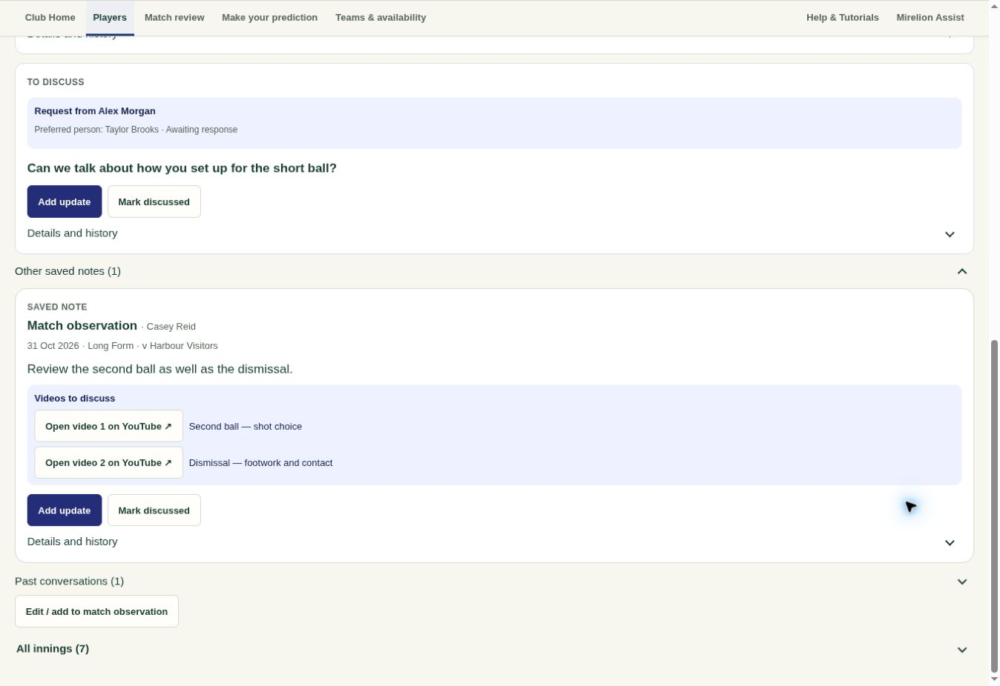
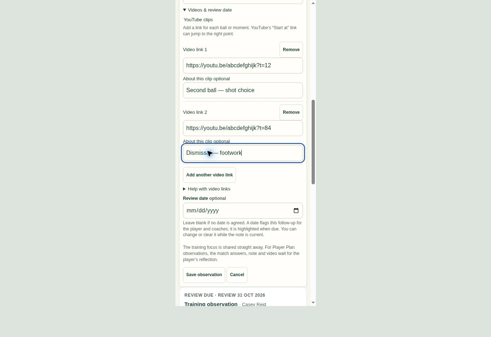

# Match observation videos and clearer actions — .315

The observation workspace now says Edit / add to match observation and omits the adjacent Training observation entry. Match observations offer Add another video link, creating another URL and short description field on each click. Contributors can remove an individual clip, save clips without assessment answers, and use different start times in the same YouTube video.

Saved clips appear as direct Open video on YouTube buttons with their descriptions. Playback opens on YouTube in a new tab; there is no embedded player, automatic video download or copying/pasting step.

The existing protected coaching-video row retains the first link and an ordered JSON array of additional links. Existing single-video observations continue to work. Old-client edits preserve additional links, while an old-client attempt to clear an unseen multi-clip list asks for a refresh. The complete clip list participates in the original receipt. Dynamic editor rows are recreated during draft recovery and locked while a save is uncertain. Authorship, shared innings, access checks and independent player-reflection gating are unchanged.

## Validation

- 34 focused tests passed: six multi-video demo tests, eight saved-fixture/independent-contribution tests, six observation safety tests and fourteen feedback-flow tests. Coverage includes both product combinations, individual removal, invalid URLs, legacy single links, timestamps, draft rows, interrupted saves and exact-request recovery.
- A rollback-isolated production SQL test passed for legacy and multi-link saves, shared readback, true video-only contributions, receipt replay after later edits, invalid input, access denial, reflection gating, separate contributors, removal and old-client compatibility. All synthetic records and queued messages were rolled back.
- Security and performance advisor findings were unchanged: no added or removed finding keys in either report. No new table, permission or background job was introduced.
- Desktop browser verification saved two clips and displayed both buttons beside their descriptions and the renamed action, with no Training observation button alongside it. Phone verification added two clips, checked full-width fields and confirmed the save.
- Syntax, demo freshness and whitespace checks passed; the generated demo still uses the same 73 shared modules.

## Deployment

Apply `20261031071224_observation_video_links.sql` before the .315 client. Its SQL is mirrored in `Database/observation_video_links.sql`. It adds the optional ordered clip list and updates the existing save/read functions without rewriting stored observations. The bounded list accepts up to 20 clips and retains the existing fixture-observation payload limit.
