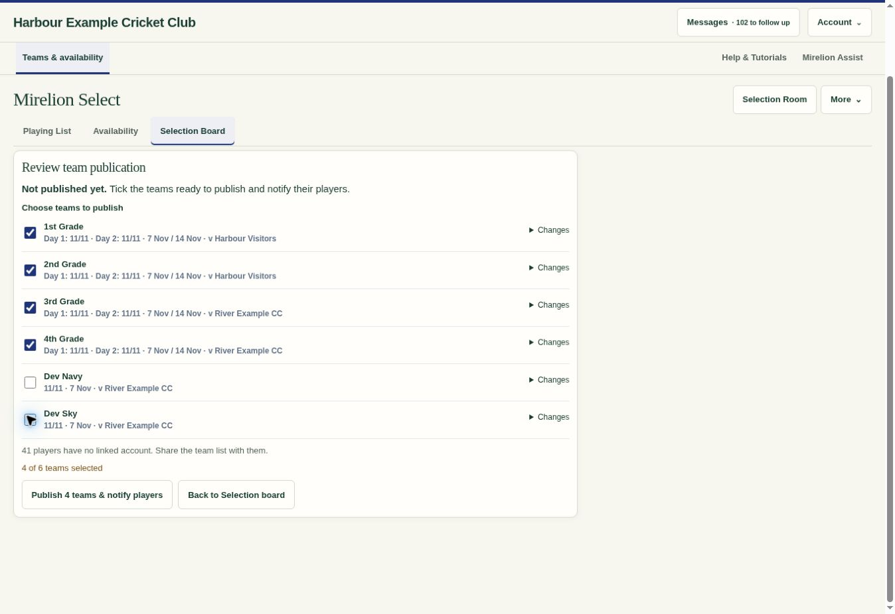
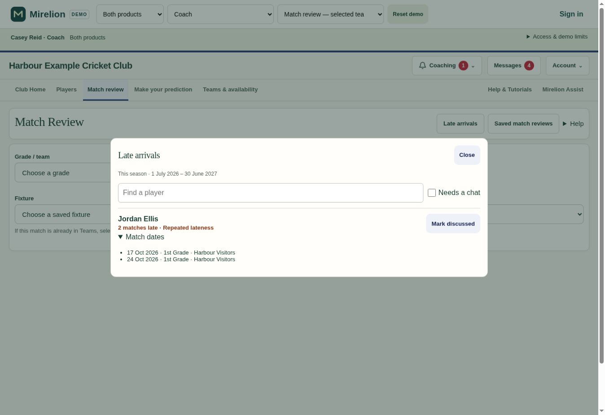
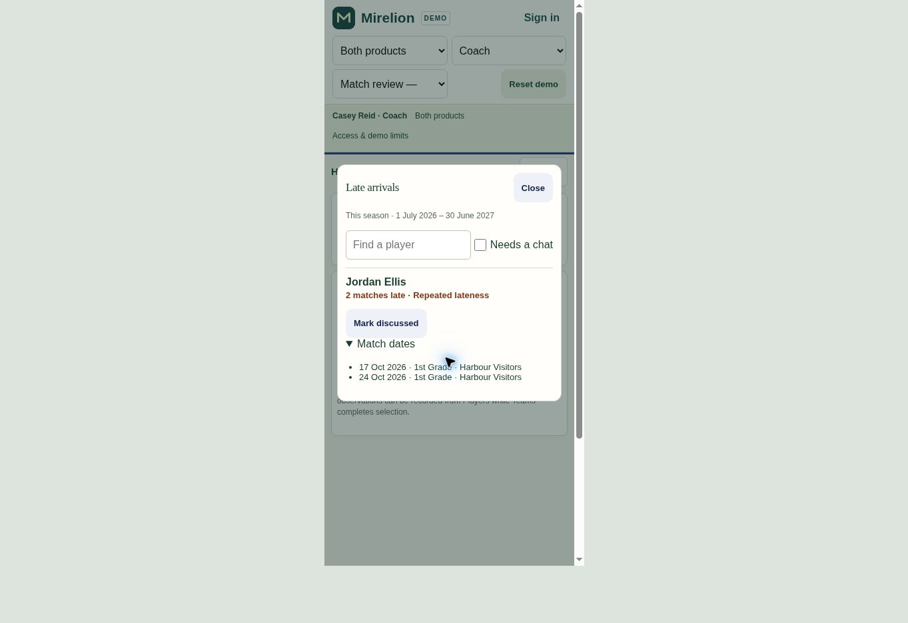

# Selective publication and shared match arrivals — .312

The Head of Selections can publish ready teams within a Selection Group while leaving unfinished teams in draft. Republishing a changed team no longer messages every unchanged player. Match Review and Match Observation also share a single Late to ground record for each player and fixture.

## Behaviour

- Publication review has a checkbox for each changed team. Validation, role warnings, vacant-place acknowledgements, the player-account count and the final Publish/Republish count follow the checked teams. Existing group authority, revision checks, overlapping-fixture protection and identical-request retry remain enforced. Publishing four grades leaves both Dev League drafts and their published snapshots unchanged; the Dev teams can be published later.
- The server compares each linked player's old and new playing days, batting positions and captain/keeper appointments. Added, removed and moved players receive updates; unchanged players do not. Shared ground, date/time, meeting, opposition, format, overs, grade or cancellation changes affect the whole team. Scoped selectors, relevant captains and appointed staff retain oversight notices. A player moving between two published teams receives one combined message.
- Late to ground saves independently of coaching assessments, using the canonical fixture and Club Batting player IDs. Its unique key spans observers and innings, including two-day matches. Repeated checks are one occurrence. Conflicting corrections require a fresh read; persistent request receipts prevent a retried old request from overwriting a newer correction. New individual-match entries reuse the existing canonical fixture resolver.
- Match Review → Late arrivals opens a searchable, permission-scoped roll for the club's current season, using its existing season-start month and timezone. Two distinct matches flag repeated lateness. Mark discussed retains match dates and counts; a later occurrence needs attention again. Unchecking an incorrectly recorded flag removes it from the count. No lateness messages are sent automatically.
- Arrival code loads only when needed. Team redraws reuse the loaded state, and the roll loads only when opened. The generated fictional demo uses the same UI. Its permission checks now short-circuit existing edit grants, and deterministic captain-expiry calculations reuse their results, without changing role permissions.

## Validation

- 20 focused UI/integration checks passed: selected-team publication, unfinished teams, short-team acknowledgement scope, no selection, lost-response retry, Match Review entry, shared arrival controls across both forms and innings, discussion history, and existing coaching-save safety.
- Two additional demo role/group-access checks passed across the allowed journeys and independent group heads.
- Two PGlite suites execute the shipped SQL. They cover notification audiences, batting-order and appointment changes, shared arrangements, combined team moves, duplicate arrival writes, stale corrections, original receipts after later changes, player/club access, current-season counts, discussion receipts, new manual fixture resolution and stale fixture identity.
- `Tests/publication_arrivals_live_test.sql` passed against the deployed database using a synthetic club. It exercises the real publishing, permissions and arrival functions, then rolls back every synthetic row and message. Both arrival tables were empty afterwards. Anonymous RPC execution, private RPC execution and direct authenticated table access are denied; the public RPC checks current coaching and per-player access.
- Syntax checks, `git diff --check`, and `node Scripts/build-demo.mjs --check` passed. Desktop and 390px phone browser checks confirmed readable checkboxes, reachable publication actions, shared arrival state, corrections, repeat flags and discussion history.

Supabase migrations applied successfully: `20261030224433_selective_publication_notifications` and `20261030224448_shared_match_arrivals`. Post-change advisors retain the pre-existing findings. Expected additions are two private RLS tables with no direct policies, the authenticated RPC with server-side checks, and five newly created indexes initially reported as unused. No new anonymous exposure or unindexed foreign keys were introduced.

## Screens checked

