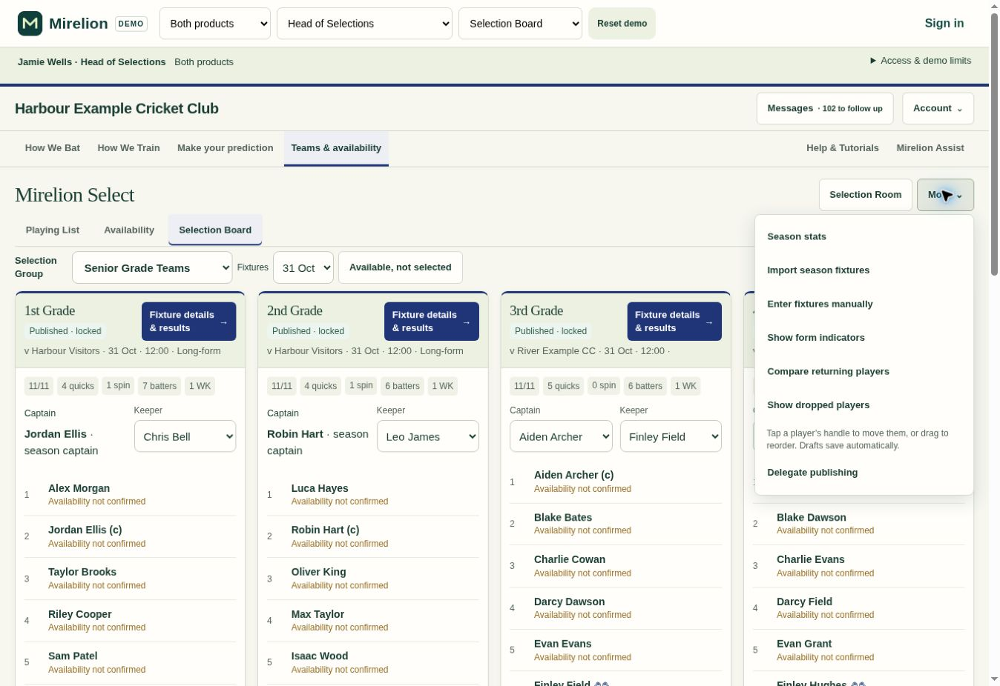
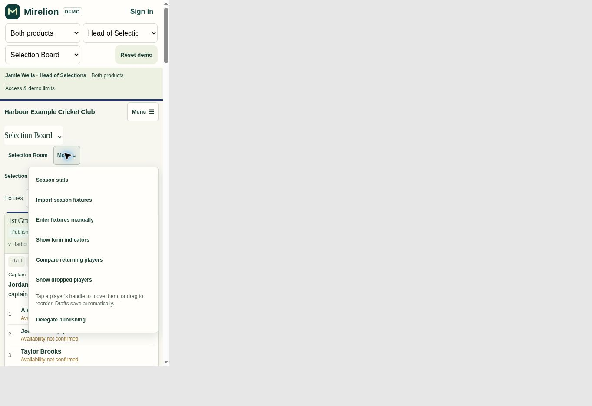

# Remove redundant Selections reload — 0.8.62.318

Remove Refresh / Reload latest changes from Club Selections → More, including its click handler. Normal browser reload remains available. Omit More when the current role and section have no remaining permitted actions; keyboard handling tolerates the absent menu.

Regenerate the shared demo and update existing reload tests to exercise the underlying renderer instead of the removed button. No database, automatic results, selection-save or publication behaviour changes.

Validation: JavaScript syntax, demo freshness and diff checks pass. All 20 focused navigation, publication-validation and shared Season stats integration tests pass. Browser inspection of the delivered demo confirms the remaining menu actions on desktop and at 390px phone width.

The broader test run still encounters the old board harness's removed `seMountStats` dependency and date-dependent availability/returning-player demo assumptions. The same failure causes reproduce against unchanged .317; they are outside this menu-only change. Existing dropped-player test references were also moved off the removed button without changing their assertions.

