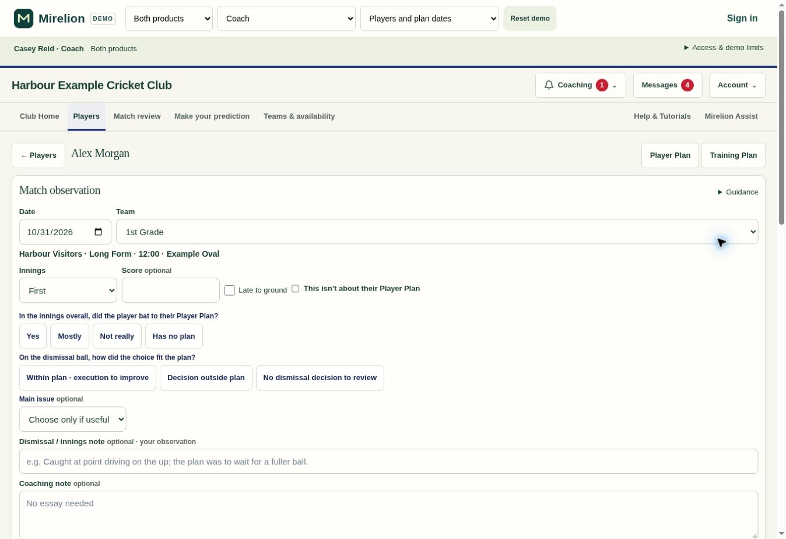
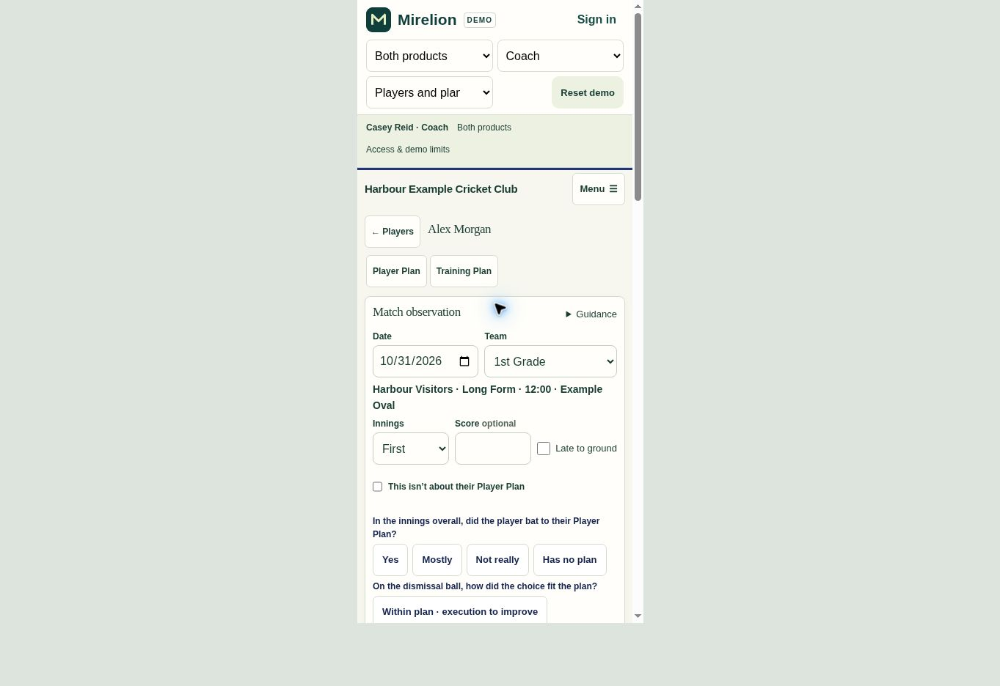

# Saved-fixture Match Observations — .313

Match Observation was loading fixtures but defaulting to a new manual match. Changing the date did not select the saved fixture, so the form could show the first enabled format instead of the match's actual format. The editor now chooses an existing fixture by date and team and gets straight to the observation questions.

## Behaviour

- One matching fixture is selected automatically; multiple matches on the same day require an explicit choice with team, opponent, time and format. Both playing days of a long-form fixture resolve to its canonical start date. Separate innings retain their own observations.
- Opposition, format, ground and start time come from the shared saved fixture. Unpublished teams do not hide the fixture. No new-fixture option or manual match-identity fields appear in the editor. Missing fixtures direct the user to the appropriate fixture-management page.
- Existing player innings reopen the coach's own latest contribution. Other authors' work remains attributed to them. Ambiguous legacy links and conflicting fixture identities stop for correction rather than silently combining records. This release does not reorganise all Coach Conversation cards or merge historical duplicate observations.
- The compact editor groups date/team, match details, score and the shared late-arrival flag. Long guidance and review/video controls are collapsed. Observation choices retain accessible explanations and touch targets. Innings appears only where relevant.
- Standalone Club Batting retains downloading and manual fixture management under Fixtures, with the More action labelled **Add fixture manually**. Linked clubs continue using Select's existing fixture workflow; no duplicate management page is added.
- The fixture controller loads only when opening an observation. It reuses the already-loaded coaching feedback and performs one saved-fixture read, without background downloads or selection scans. New drafts are scoped to fixture and innings. Inline retry and reopened pending-save recovery preserve the original request receipt.

## Verification

- 22 focused UI and demo checks passed: fixture selection, two-day and multiple-match handling, both products, existing contributions, uncertain-save retry and reopening, draft guards, standalone fixture management, existing coaching safety and shared late arrivals.
- The PGlite suite executes the shipped SQL and covers fixture/innings identity, legacy ambiguity, linked history, cancelled and opted-out fixtures, authentication, player/club access and anonymous denial.
- The migration was applied successfully. A read-only live check under the existing coach account returned Newcastle City's 31 October 2026 1st Grade fixture against Hamilton-Wickham as Limited Overs, 10:00 at Newcastle Number 1 Sportsground. Anonymous RPC execution remains denied. No live coaching notes or messages were created for verification.
- Supabase security and performance advisor findings are unchanged from the pre-release snapshot.
- Syntax, whitespace and generated-demo freshness checks passed. Desktop and 390px browser checks verified the compact layout, readable controls and no horizontal form overflow. GitHub publication repeats the focused tests and verifies the exact reviewed source tree before committing.

## Screens checked

