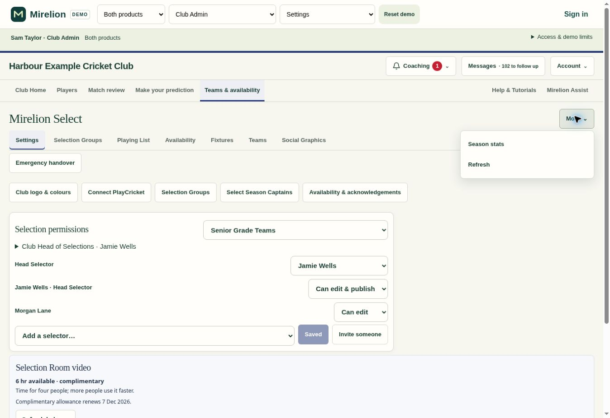
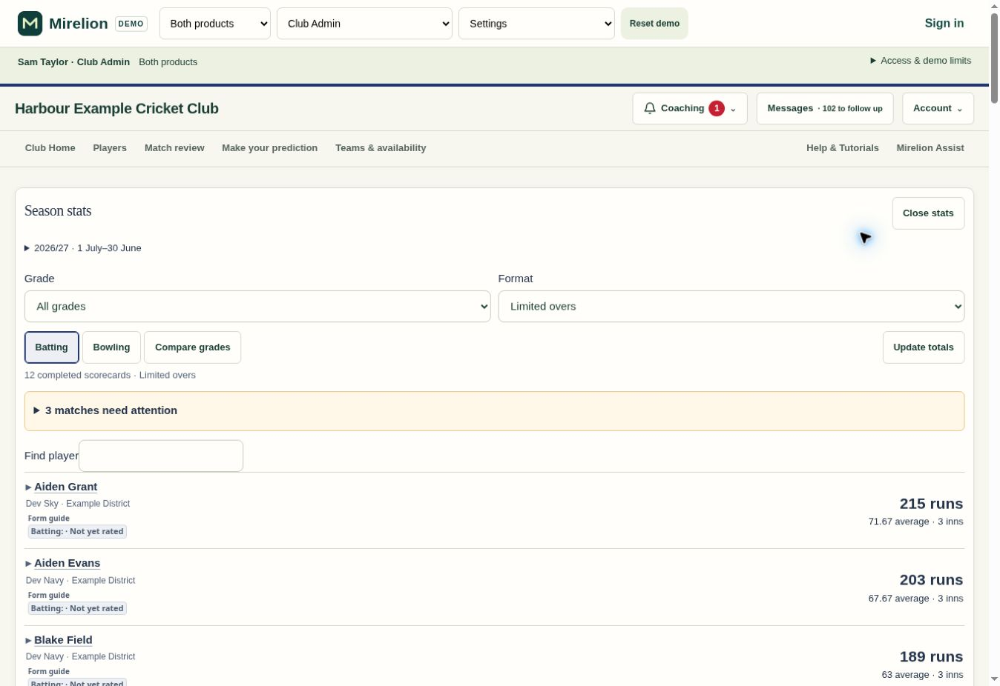
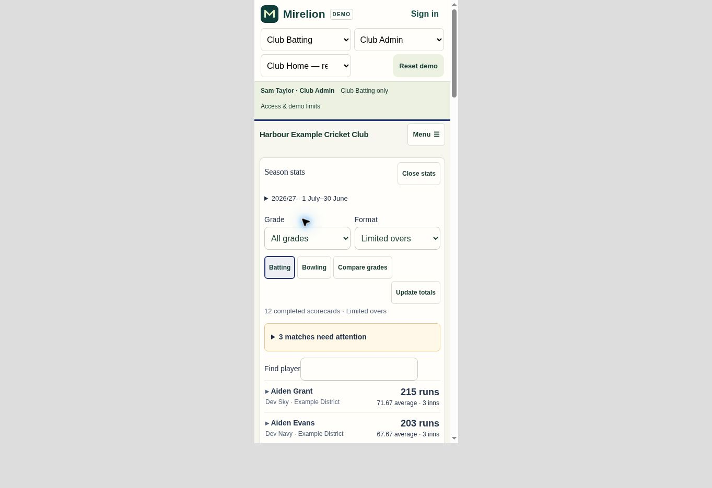

# Shared Season stats and confirmed player names — .316

Season stats is available again from Club Selections → More for Mirelion Select and linked clubs. Club Batting-only staff have one Season stats navigation entry using the same view, season dates, saved scorecards and calculation engine. Linked clubs do not get a second view or duplicate results.

The page loads on explicit entry. It retains existing selector, captain and coaching scopes, unions overlapping permissions without duplicating scorecards, and does not grant Select to a Club Batting-only club. Ordinary player access is denied. Select comparisons retain last-published line-ups and explicit current-draft comparisons; standalone clubs compare all season players without implying a selected batting order. Closing returns to the previous workspace, filters survive Back/Forward, and unsaved season dates retain their leave guard.

The scorecard identity chooser previously replaced an active short-name suggestion with an inactive exact-name row, producing a Yes, link player button that the server correctly rejected. Inactive rows no longer replace active candidates. Ambiguous identities retain the existing chooser and explicit confirmation. A confirmed PlayHQ identity now uses the trusted source spelling on its roster and, for a participating team, the existing Club Batting profile. It preserves IDs, account profiles, history, receipt retries, stale-name checks and Club Batting opt-outs.

## Validation

- 79 focused tests passed across the shared demo journeys, Season stats UI/calculations and scorecard team confirmation. The standalone comparison test was extended and the four affected demo tests rerun successfully.
- Three rollback-isolated SQL suites passed against the real schema: existing Season stats permissions/settings/identities; standalone and linked shared scope/deduplication; and scorecard identity, official-name adoption, opt-out, stale-name and exact-request retry. Synthetic data was rolled back.
- Security and performance advisor finding keys were unchanged after both migrations: 456 security findings and 295 performance findings, with no additions or removals.
- Browser verification covered the single More entry and desktop stats, plus Club Batting-only navigation and the shared view at 390px width. Phone rows, filters and controls remain visible without horizontal page overflow.
- Syntax, generated-demo freshness, migration mirrors and whitespace checks passed. The demo uses the same 73 shared modules as the app.
- The user-confirmed beta player repair was dry-run first, then applied transactionally using the existing guarded consolidation helper. The registered official-name roster retains the original batting profile and all existing scores, plans and coaching records. Account and registration details were preserved; the old duplicate remains inactive. Derived plan reminders follow the canonical roster. No private player identifiers are included in this release.

## Deployment

Apply `20261031073610_shared_season_stats.sql` and `20261031075257_scorecard_official_names.sql` before the .316 client. Both are mirrored under Database. These replace existing protected functions without adding a table, public grant, background job or video-processing service. The previous .315 observation links remain direct YouTube links; embedded bounded playback and automatic dismissal detection are future work.
