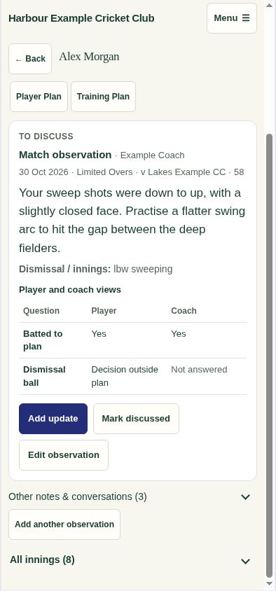

# Coaching comparison and simpler conversations — .335

An unanswered dismissal assessment was being treated as disagreement even when player and coach had both selected Yes for batting to plan. Follow-up signals now use the same comparison of jointly answered questions as the innings view. Missing answers are displayed as Not answered and cannot generate a difference flag.

The open observation shows a compact Player / Coach comparison of the saved batting-plan and dismissal choices. Actual differences identify their question directly, without a repeated generic warning. Players see the same comparison after their independent reflection is available. Comment-only entries remain immediately readable and do not gain an unnecessary comparison.

Routine notes and completed conversations share one collapsed collection. The generic Details and history wrapper and repeated guidance are removed. Edit observation is directly available to its authorised author; real earlier updates and edits remain accessible only when present. Staff conversations reuse the existing All innings record instead of embedding it again in every note. Training-focus controls are omitted from comments without an agreed task. Another observation remains available from the existing fixture workflow.

Validation: 28 regression checks passed across comparisons, coaching messages, conversation updates/completion, observation entry and the focused player page. Coverage includes blanks on either side, genuine differences, no-plan/general comments, attribution, reflection visibility and interrupted-save retry. App syntax, whitespace and shared-demo freshness checks passed. The delivered demo was inspected at desktop and 390-pixel phone widths; coach and player comparisons have no horizontal overflow. Direct Edit observation reopens the correct saved contribution with its blank dismissal assessment unchanged.

This release uses existing authorised data and adds no requests, background calculation or database changes. No real observation, player reflection or conversation status was changed.

