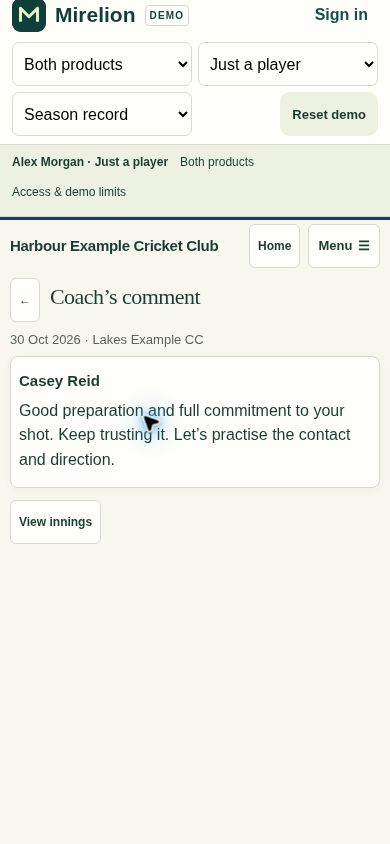

# Player comment reading — .330

A coaching update used to open the full innings editor, expanded innings evidence and season history. A player looking for one comment could encounter several screens of unrelated fields. Match updates now open the exact attributed contribution. Comment-only entries are readable immediately. An explicit Yes, Mostly or Not really assessment opens two independent reflection questions, then shows the comment after a confirmed save.

Coach Conversations uses the same focused review action. Optional reflection text and the comparison of player/coach views stay collapsed. View innings retains access to the complete record. Browser history distinguishes separate observations on the same innings. Missing or inaccessible observations never substitute another author's comment.

The focused route reuses get_my_innings and the existing receipt/revision-protected save. It skips preparation, training focus and engagement requests. Returning to the full record loads its preparation data normally. Existing scores, fixture identity, player notes, videos, coach assessments and authorship are preserved. Interrupted saves retain the original request and use Check previous save before further edits.

## Validation

- 95 JavaScript regression checks passed across player comments, coaching inbox/feedback, innings/reflection, drafts, navigation, shared captain/coach contributions, video saves and the complete demo.
- The navigation and feedback unit harnesses were updated with stubs for existing optional arrival/replay/contribution components; production controls were not disabled.
- Database migration `20261101045302_explicit_match_assessment_visibility` applied successfully. Its atomic verification exercises the real authenticated role for comment-only, issue-only, dismissal-only, Yes, Mostly, Not really and no-plan observations. It checks table RLS, RPC visibility, video access, notification state, reflection/save behaviour and outsider rejection. Synthetic records are rolled back; zero synthetic clubs remain.
- Existing ownership and club permissions, function grants, and explicit-assessment reflection protection remain in place. No real coaching record or reflection was changed. Security advisory findings are unchanged from the pre-migration snapshot.
- Application syntax, whitespace checks and the generated demo manifest passed. The demo uses the same application implementation.

## Visual check

The real demo application was exercised using a fictional player with equivalent unreflected feedback, rather than signing in as a real player. At a 390 × 844 phone viewport, the .329 notification destination measured 4,246 px high (2,202 px for the form). The .330 assessment destination measures 615 px (455 px for the form); the attributed comment-only destination measures 292 px, with no horizontal overflow. Saving the two answers reveals the comment directly. Desktop layout was also inspected.

The normal season record remains available on explicit request. This change focuses the reading/review destination; it does not remove the player's wider innings history.

