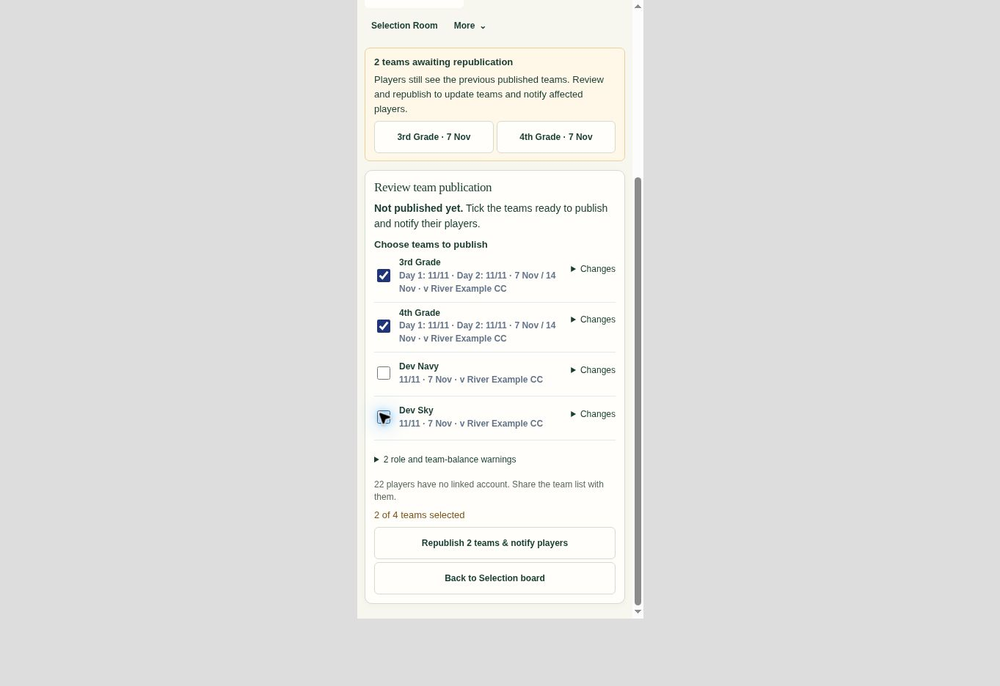

# Team publication workflow · 0.8.62.346

The Selection Board previously offered **Lock again** after editing, although publication requires an open team. Publication review also treated reordered JSON object keys as changed appointments, unnecessarily saving drafts and increasing the chance of conflicts between selectors. A separate balance-warning acknowledgement prevented the final publish button from proceeding even after a Head had chosen the teams.

## Result

- An unlocked published team offers **Relock (if no changes made)** only while its details and ordered lineup still match its published version. Once changes exist, that button disappears and **Review & publish** is the finishing action. Publication retains its automatic lock.
- Both first publication and republication retain readable balance warnings without the extra acknowledgement checkbox. Existing eligibility, availability, overlap, captain, team-size and publishing-permission checks remain.
- Explicitly opening publication review reads the latest saved teams once. JSON object key order cannot cause an appointment save or false unpublished-change flag. Array order, player identities and real detail changes remain significant. Date/group navigation and ordinary redraws add no requests.
- Locked changed future teams remain visible in review with an explicit **Unlock for changes** action. Unlocking preserves the other checked/unchecked teams and never publishes automatically. Completed-fixture correction protections remain.
- If another selector changes a team before Relock, the revision guard refuses the stale request, reloads the latest team and clears the confirmed-rejection retry state. Uncertain outcomes retain the existing identical-request retry.
- Unlocking without edits causes no publication or player notification. Explicit Relock and the existing 30-minute expiry both preserve the published team.

## Verification

58 focused automated checks passed:

```sh
node --test Tests/publication_lock_flow_demo_test.cjs \
  Tests/publication_validation_demo_test.cjs \
  Tests/twelve_player_publication_demo_test.cjs \
  Tests/team_publication_ui_test.mjs \
  Tests/team_availability_admin_demo_test.cjs \
  Tests/selection_drawer_safety_test.cjs \
  Tests/selection_unavailable_drafts_test.cjs
node --check app.js
node Scripts/build-demo.mjs --check
git diff --check
```

Coverage includes actual generated-demo flows, database-like JSON key ordering, concurrent saved edits, explicit review refresh, late/stale responses, double clicks, scoped team choices across unlock, successful first publication/republication without the warning checkbox, lost-response retry, required selection checks, completed corrections, conditional Relock and expired unchanged windows.

The older isolated `captain_board_ui_test.cjs` was also checked. Its 19 failures reproduce unchanged against the previous release (including missing `selectionEvidence` in its mock environment); it was not used as a passing release check or changed in this release. Two obsolete expectations in the touched drawer tests were updated to the already-shipped Club Admin unlock permission; the non-Admin scoped denial checks remain.

Browser QA used synthetic demo fixtures at a 390px frame width. The review had no horizontal overflow (375px content/scroll width), showed the optional warnings without an acknowledgement checkbox, and successfully republished just 3rd and 4th Grade. Both then displayed Published · locked; Dev fixtures remained drafts. An unchanged first-grade team offered Relock and returned to Published · locked; changed teams had no Relock action.



Live database inspection was read-only. No real team selections, publications or notifications were performed during verification. No database migration is required.
