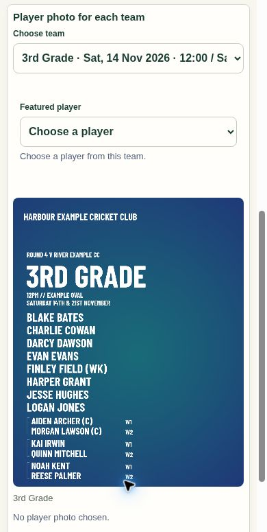

# Mirelion 0.8.62.362 — reusable team graphics

Two-day fixtures now produce one team graphic with both playing dates and every bracket partner. Regular players appear once; partners share a grouped position with W1/W2 labels (D1/D2 for consecutive days) and the correct captain/keeper duties. Preview, download, ZIP and posting review use the same list. Either partner can supply the featured photo. Existing completed-post images remain unchanged.

Team heading geometry follows the saved layout rather than the presence or transparency of a player photo. The new Team heading size control persists with the club template and is also supported by the graphic assistant. A text-size request cannot be redirected into background generation. Each club keeps its own previous example, background, fonts and colours; no Newcastle City branding is applied to other clubs.

All six social graphic types share automatic middle-name omission. Explicit preferred labels take priority; compound surnames and duplicate-name distinctions are retained. Player records and published selection snapshots keep their original names.

## Validation

- 109 targeted JavaScript tests passed across names, fixture grouping, real canvas layout, photo selection and position, the delivered demo workflow, publishing previews, saved history, permissions, loading, Results and award rendering, and the mocked refinement service. A stale Team of the Week test was updated to verify the existing rule that reading example names preserves the approved composition, then passed separately.
- Two additional award refinement/recovery test files passed, including Apply/Undo and no extra AI calls. Demo navigation and role integration: 21 tests passed.
- Canvas checks cover 1, 3, 5 and 11 bracket pairs, all three layouts and fonts, missing/transparent/ordinary photos, changing day roles and date boundaries. The common 1–3 pair cases retain readable lettering and all rows stay inside the graphic.
- The delivered demo was inspected in the browser at desktop and 390-pixel phone width. Saved heading size was changed through the UI and reused for another team. The fictional demo's three pairs are shown below.
- Live database tests ran inside rolled-back synthetic transactions: both-day feature choices, retries, stale revisions, atomic failure, invalid players, current export keys, saved heading settings and invalid input. The existing completed-fixture and photo-position suite also passed.
- Migrations applied: `20261113091451_social_fixture_team_graphics` and `20261113092515_social_heading_template`. Function ACLs, security modes and empty search paths were read back; no grants were broadened.
- `club-social-style` version 18 deployed with JWT verification enabled. All five deployed files match the reviewed sources. Provider responses were mocked in tests; no paid AI call or real social post was sent.
- Final security advisor check found no findings involving the changed functions. Existing project advisories remain outside this change.
- `node Scripts/build-demo.mjs --check` and `git diff --check` passed. Social modules remain loaded on demand; no player-startup downloads or polling were added.

