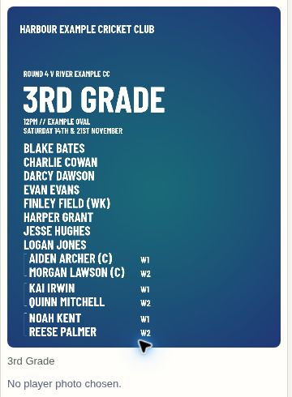

# Mirelion 0.8.62.363 — consistent team-list names

Bracketed players previously used a smaller font than regular players. Team lists now measure the complete roster and choose one common name size that fits both the available height and every full display label, including captain/keeper duties. Long names also participate in that shared fit instead of shrinking independently. The existing bracket lines, day labels, saved heading and artwork remain in place.

The same renderer supplies previews, downloads and posting images. Draft posting previews receive a new version so newly reviewed graphics use the updated layout. Previously saved or posted images stay unchanged. No database or Edge Function update is needed, and no new requests or startup loading are introduced.

Validation: 39 targeted checks passed across the canvas renderer, complete demo workflow, photo positions, loading, history and team-list workflow. Layout assertions cover 1, 2, 3, 5 and 11 bracket pairs, all three layouts, long names and different fonts. They verify one actual font size for every name, complete measured widths without horizontal compression, no overlapping rows, retained dates/roles, and unchanged heading geometry. The delivered demo was visually checked on desktop and at 390-pixel phone width. The demo freshness check and whitespace check passed.

