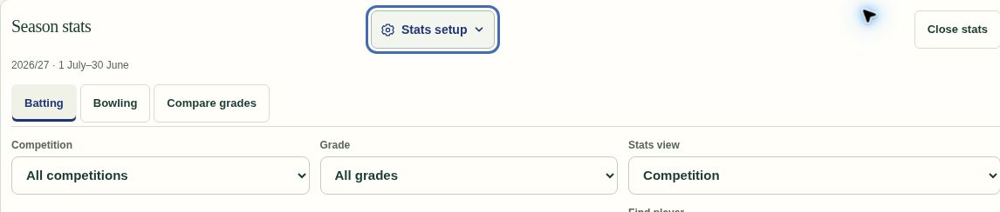
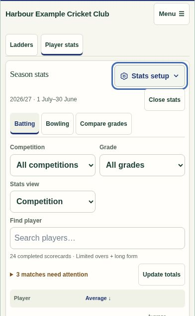

# Stats setup heading placement — .368

Move the approved Stats setup control onto the Season stats heading row at the position marked by the user. Season dates remain immediately beneath the heading. Keep Close stats at the far edge; on phones it shares the dates row so the title and setup control remain together.

An ordinary keyboard-accessible button now controls the existing setup panel using aria-expanded, aria-controls and hidden. Preserve drafts, saved setup, dates, role checks and all statistics behavior. Update the existing setup/save test to exercise opening, closing and accessible state before editing.

The Season stats UI and shared delivered-demo suites pass all 40 tests. The focused expanded-state/save test also passes. Demo build freshness and whitespace checks pass; no database changes. Only the application entry point and changed panel move to .368.

Published application commit: `c53f776164edc96fd8c4af8b59dcc04b6d5536fc`. GitHub Pages run `43587913858` completed successfully. All five deployed application/demo files matched the tested checkout byte for byte; hashes are recorded in [deployed-files.json](stats-368/deployed-files.json).

Browser verification of the published shared demo confirms the setup button is on the heading row at desktop width and remains beside the heading at 390 px phone width. Season dates remain underneath, and Close stats stays accessible. Enter opens the existing settings panel with aria-expanded=true; Space closes it with aria-expanded=false.

